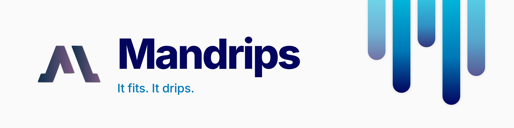

---

Mandrips is a demonstration online clothing storefront, built as an assignment for the Web Development module at Nanyang Polytechnic. It is non-commercial and not affiliated with Uniqlo.

The site is plain HTML, CSS, and TypeScript browser modules with no framework or backend. Products load from a JSON file, the cart lives in the browser's local storage, and the generated pages are served as static assets from a Cloudflare Worker.

## Features

- **Catalog**: Browse products filtered by type and price range.
- **Product Pages**: Pick a color and size, then add the item to the cart.
- **Size Guide**: Check measurements before choosing a size.
- **Cart**: Review items and the total, kept in local storage.
- **Mock Checkout**: Fill in a checkout form and get a receipt with an order number, without any payment.

## Tech Stack

- [Bun](https://bun.sh) for the build script, tests, linting, formatting, and type checking.
- [TypeScript](https://www.typescriptlang.org) for browser modules, compiled without bundling.
- [Cloudflare Workers](https://developers.cloudflare.com/workers) for hosting the static assets, deployed with the `cf` CLI.
- [Font Awesome](https://fontawesome.com) for icons.

## Getting Started

### Prerequisites

- [Bun](https://bun.sh) 1.4.5 or newer
- [Just](https://just.systems)

### Setup

1. Install dependencies.

   ```sh
   just setup
   ```

2. Start the development server and open `http://localhost:3000`.

   ```sh
   just start
   ```

## Documentation

- [Cloudflare Development](docs/guides/cloudflare.md)

## License

Licensed under the [MIT License](LICENSE).
